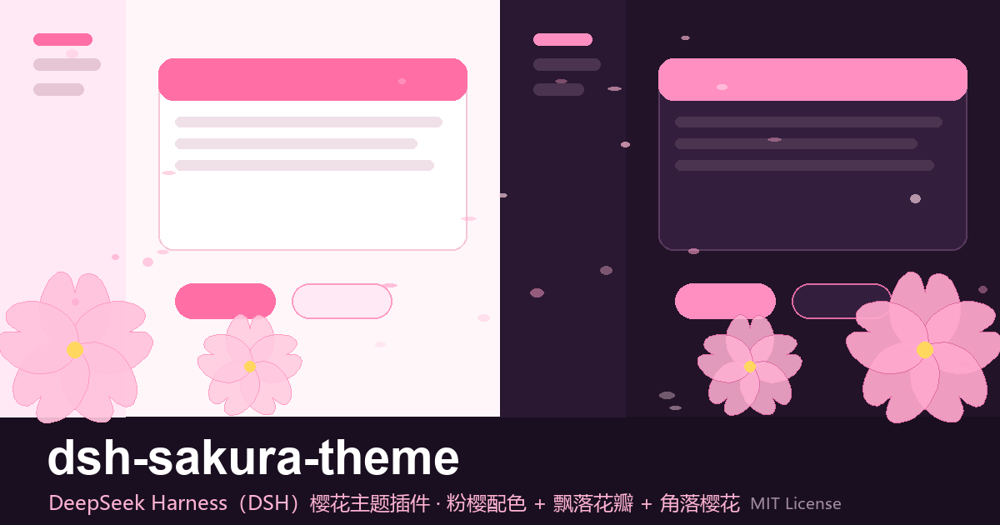

# 🌸 dsh-sakura-theme



DeepSeek Harness（DSH）樱花主题插件：**粉樱配色 + 飘落花瓣 + 角落樱花水印**。

桌面端（官方 Electron 客户端）与 Web 端均生效；插件安装在用户 profile 中，**不修改 `app.asar`，DSH 更新后不会丢失**。

> 主题示意图（左：浅色 / 右：深色）：粉樱配色、樱花水印与飘落花瓣。实际界面会随外观设置自动切换。

## ✨ 特性

- **粉樱配色**：浅色为樱花白底 + 樱粉点缀，深色为月夜樱紫，自动跟随外观设置
- **飘落花瓣**：34 片真正独立的花瓣元素，大小 / 下落速度 / 相位 / 水平漂移 / 透明度随机；顶部淡入、底部淡出，负延迟让花瓣一开始就散布全屏
- **角落樱花水印**：右上 / 左下各一朵（深色模式自动调整透明度）
- **细节**：侧栏粉樱渐变、`🌸` 列表标记、粉色选中色 / 焦点环、更大的圆角
- **无障碍**：遵循系统「减少动态效果」，开启时自动不生成花瓣

## 📦 安装

### 桌面端（官方 Electron 客户端）

```bash
dsh plugin --profile desktop add github:MiaoxueX/dsh-sakura-theme
```

> 也可以在桌面端会话里直接说「用内置 plugin_manager 安装 dsh-sakura-theme」。
> 安装后**彻底退出客户端**（含托盘）再重新打开。

### Web 端（`dsh web`）

```bash
dsh plugin --profile web add github:MiaoxueX/dsh-sakura-theme
```

安装后重启 `dsh web` 并刷新浏览器页面。

### 本地开发安装

```bash
dsh plugin --profile desktop add link:<本仓库绝对路径>
```

> ⚠️ `link:` 是软链安装：安装后不要移动 / 重命名本目录，否则需要重新 add。

## 🗑 卸载

```bash
dsh plugin --profile desktop remove dsh-sakura-theme
```

重启客户端即恢复原样。

## 🎨 自定义

主题样式在 [`theme.css`](./theme.css)，直接修改后重启 DSH 即可生效。常见调整：

| 想改什么 | 改哪里 |
| --- | --- |
| 品牌粉 / 背景色 | `--dsw-alias-brand-primary`、`--dsw-alias-bg-base` 等变量 |
| 花瓣数量 / 大小 / 速度 | `lib/index.js` 中 `buildRowScript()` 里的 `i<34`、`z=...`、`du=...` |
| 角落樱花水印 | `theme.css` 里的 `html:before` / `html:after` |
| 列表樱花标记 | `theme.css` 里的 `li::marker` |

## ⚙️ 原理

DSH 桌面端的 `index.html` 直接从安装包静态 dist 读取，宿主 `renderIndex()` / `tapIndex` 都不经过它；**唯一生效的注入通道**是 `webserver/index-inject` 推送的结构化行，经 IPC 交给页面侧解释器逐行应用。

本插件在 `apply()` **一开始**就注册注入行（桌面端注入表在启动时一次性收集），推入一条**内联 `script` 行**：

1. 注入 `<style>`（`theme.css` 的内容）
2. 按随机参数生成花瓣元素

> 注意：行类型必须用内联 `script`，不能用 `script-src` —— 桌面端对 `script-src` 是「加载失败即 reject 整个 boot」，会把应用卡死。

## 📄 License

[MIT](./LICENSE)
